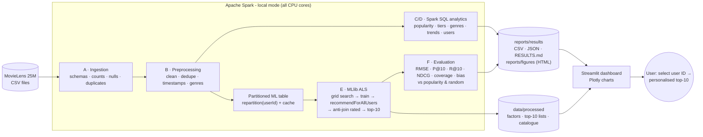

# 🎬 Taste, Trends & Algorithms

### Big Data-Driven Movie Recommendations and Popularity Bias Analysis

| | |
|---|---|
| **Student** | Samruddhi Kanade |
| **Roll number** | 10251 |
| **College** | Fr. Conceicao Rodrigues College of Engineering (FR CRCE) |
| **Subject** | Big Data Analytics |
| **Academic year** | 2026-27 |
| **Stack** | Python · Apache Spark (PySpark, Spark SQL, MLlib ALS) · pandas · NumPy · Plotly · Streamlit · Git |

---

## Contents

1. [Abstract](#1-abstract)
2. [Problem statement](#2-problem-statement)
3. [Motivation](#3-motivation)
4. [Objectives](#4-objectives)
5. [Research paper](#5-research-paper)
6. [Dataset](#6-dataset)
7. [System architecture](#7-system-architecture)
8. [Technology stack](#8-technology-stack)
9. [Methodology](#9-methodology)
10. [Algorithms used](#10-algorithms-used)
11. [Implementation details](#11-implementation-details)
12. [Results](#12-results)
13. [Dashboard screenshots](#13-dashboard-screenshots)
14. [Limitations](#14-limitations)
15. [Future scope](#15-future-scope)
16. [Installation (Windows)](#16-installation-windows)
17. [Execution](#17-execution)
- [Testing](#testing) · [Troubleshooting](#troubleshooting) · [Publishing on GitHub](#publishing-on-github) · [Verification status](#verification-status)

---

## 1. Abstract

Recommender systems decide what millions of people watch, read and buy. This project builds a complete Big Data pipeline on the **MovieLens 25M** dataset (25 million ratings, 162k users, 62k movies) with **Apache Spark**. Spark SQL is used to analyse rating behaviour, genres, release years and movie popularity at scale. A **collaborative-filtering recommender** based on matrix factorisation, trained with **Alternating Least Squares (ALS)** in **Spark MLlib**, follows the concepts of Koren, Bell & Volinsky (2009). The model is evaluated with **RMSE**, **Precision@10**, **Recall@10**, **NDCG@10** and **catalogue coverage**, and compared against a **most-popular baseline** and random recommendations. The project also measures **popularity bias** (average recommendation popularity, Head/Mid/Tail exposure, Gini coefficient) to test whether personalised recommendations favour movies that are already popular. Everything is presented in an interactive **Streamlit** dashboard where a user ID can be selected to receive personalised top-10 recommendations, and where new users can get recommendations by rating a few movies.

## 2. Problem statement

Given millions of explicit movie ratings, (a) analyse user preferences and movie popularity efficiently with distributed processing, (b) predict how a user would rate movies they have not seen and recommend the 10 best, and (c) determine whether these personalised recommendations are genuinely more useful and more diverse than simply recommending popular movies, or whether they inherit and amplify popularity bias.

## 3. Motivation

* Ratings data is **large and sparse**. In MovieLens 25M, more than 99% of user × movie combinations have no rating, so single-machine tools struggle and the right tool is a distributed engine.
* Matrix factorisation won the **Netflix Prize** and is still a foundation of industrial recommenders.
* Accuracy is not the whole story. If an algorithm keeps recommending the same blockbusters, niche films never get discovered: a **"rich-get-richer"** loop that affects users, creators and platforms.

## 4. Objectives

1. Ingest, validate and clean MovieLens 25M with PySpark.
2. Analyse ratings, users, genres, release years and trends with Spark SQL and visualise them with Plotly.
3. Implement ALS collaborative filtering in Spark MLlib with a train/test split and hyper-parameter tuning.
4. Generate top-10 recommendations that exclude already-rated movies, with cold-start handling.
5. Evaluate with RMSE, Precision@10, Recall@10, coverage and popularity-bias metrics against a popularity baseline. Every number comes from real model outputs.
6. Deliver an interactive dark-themed Streamlit dashboard.

## 5. Research paper

**Y. Koren, R. Bell, C. Volinsky - "Matrix Factorization Techniques for Recommender Systems", *IEEE Computer* 42(8), 2009. DOI [10.1109/MC.2009.263](https://doi.org/10.1109/MC.2009.263).**

Concepts used: collaborative filtering, matrix factorisation (r̂ᵤᵢ = qᵢᵀpᵤ), latent factors, regularised least squares, **Alternating Least Squares**, rating prediction and model learning, and the user/item **bias baseline** μ + bᵤ + bᵢ (used here as a comparison model).

> This is an **independent implementation** of the paper's concepts on a different dataset with Spark MLlib. It does **not** claim to reproduce the paper's experiments or results. See [`docs/research_paper_notes.md`](docs/research_paper_notes.md).

## 6. Dataset

**MovieLens 25M** - GroupLens Research ([download page](https://grouplens.org/datasets/movielens/25m/)). It holds 25,000,095 ratings (0.5-5★ in half stars) and 1,093,360 tag applications on 62,423 movies, from 162,541 users, collected from Jan 1995 to Nov 2019. Every user rated at least 20 movies.

| File | Content |
|---|---|
| `ratings.csv` | userId, movieId, rating, timestamp |
| `movies.csv` | movieId, title (with year), pipe-separated genres |
| `tags.csv` | userId, movieId, free-text tag, timestamp |
| `links.csv` | movieId → IMDb and TMDB ids |

The raw data is **not** included in this repository or ZIP (about 250 MB zipped, about 1.1 GB extracted). `scripts/download_data.py` downloads it, checks the MD5 checksum and extracts it to `data/raw/`. **Dev mode** uses *ml-latest-small* (about 100k ratings, same format) for quick runs.

> Citation: F. M. Harper and J. A. Konstan. 2015. *The MovieLens Datasets: History and Context.* ACM TiiS 5(4).

## 7. System architecture



More diagrams and design decisions are in [`docs/architecture.md`](docs/architecture.md).

## 8. Technology stack

| Technology | Role |
|---|---|
| **Python 3.10/3.11** | Main language |
| **Apache Spark 3.5 / PySpark** | Distributed processing in local mode |
| **Spark SQL** | Analytics queries (CTEs, window functions, explode, percentiles) |
| **Spark MLlib** | ALS collaborative filtering, RegressionEvaluator |
| **pandas / NumPy** | Small aggregated results only; fast vectorised serving and metrics |
| **PyArrow** | Fast Spark → pandas transfer and Parquet files |
| **Plotly** | Interactive charts (dashboard + exported HTML) |
| **Streamlit** | Web dashboard |
| **pytest** | Automated tests |
| **Git** | Version control |
| **Java 17 (Temurin)** | Runtime required by Spark |

## 9. Methodology

1. **Ingestion:** typed CSV loading, schemas, counts, missing values, duplicates.
2. **Preprocessing:** remove missing or invalid ratings, keep the latest duplicate, drop unknown movies, convert timestamps, parse release year and genres, then build a cached ML table partitioned by user.
3. **EDA and analytics:** Spark SQL aggregates; charts with Plotly.
4. **Modelling:** 80/20 random split, then a rank × λ grid search on a validation split of the training data, then final ALS.
5. **Recommendation:** top-150 candidates per user → anti-join already-rated movies → top-10; cold start via a popularity fallback and fold-in.
6. **Evaluation:** RMSE against two baselines; Precision/Recall/NDCG/HitRate@10 against Popularity and Random; coverage; popularity bias.

Full details: [`docs/methodology.md`](docs/methodology.md).

## 10. Algorithms used

| Algorithm | Where | Purpose |
|---|---|---|
| **Alternating Least Squares (ALS-WR)** | Spark MLlib, `src/recommendation.py` | Learn user and movie latent factors |
| ALS fold-in (one least-squares step) | `src/recommender_core.py` | Cold-start vector for a new user |
| Reference ALS in NumPy | `src/recommender_core.py` | Teaching and tests; Spark-free fallback for dev data |
| Bias baseline μ + bᵤ + bᵢ | `src/evaluation.py` | RMSE comparison (from the paper) |
| Most-popular recommender | `src/recommender_core.py` | Non-personalised baseline |
| Bayesian weighted rating | `src/analytics.py` | Fair "highest rated" ranking; cold-start list |
| Cumulative-share tiering | `src/analytics.py`, `src/metrics.py` | Head / Mid / Tail popularity tiers |
| Cosine similarity of item factors | `src/recommender_core.py` | "Similar movies" in the movie search |
| Gini coefficient, Lorenz curve | `src/metrics.py` | Exposure inequality |

## 11. Implementation details

### Project structure

```
taste-trends-algorithms/
├── app.py                      Streamlit entry point (navigation, mode switch)
├── requirements.txt            Pinned dependencies
├── pytest.ini                  Test configuration
├── config/config.example.yaml  Modes (dev/full), memory, ALS grid, paths
├── .streamlit/config.toml      Dark theme
├── src/
│   ├── config.py               Loads config and resolves paths
│   ├── spark_session.py        Local Spark session tuned for a laptop
│   ├── ingestion.py            MODULE A - CSV → Spark DataFrames, quality report
│   ├── preprocessing.py        MODULE B - cleaning, timestamps, ML table, split
│   ├── eda.py                  MODULE C - runs analytics, saves tables, exports charts
│   ├── analytics.py            MODULE D - Spark SQL queries (popularity, genres, trends, users)
│   ├── recommendation.py       MODULE E - ALS tuning/training, top-10 for all users, export
│   ├── recommender_core.py     NumPy serving, cold-start fold-in, similar movies, reference ALS
│   ├── evaluation.py           MODULE F - RMSE, baselines, ranking metrics, bias (Spark side)
│   ├── metrics.py              Metric formulas (pure NumPy, unit-tested)
│   ├── visuals.py              Plotly chart factory with the cinematic theme
│   ├── report.py               RESULTS.md + README results from real outputs
│   ├── pipeline.py             Orchestrates modules A-F
│   ├── io_utils.py             Parquet/CSV/JSON helpers
│   └── constants.py            Shared data rules
├── dashboard/
│   ├── theme.py                CSS, KPI cards, movie cards
│   ├── data.py                 Cached loaders for pipeline outputs
│   └── views.py                The 7 dashboard sections
├── scripts/
│   ├── check_environment.py    STEP 1 - inspect Python, Java, RAM, packages, Spark
│   ├── download_data.py        Download + verify + extract MovieLens
│   ├── run_pipeline.py         Full pipeline A-F
│   ├── train_model.py          Modules A, B, E, F only
│   ├── reference_als.py        Spark-free ALS on dev data (fallback/teaching)
│   ├── capture_screenshots.py  Optional automatic dashboard screenshots
│   ├── package_zip.py          Build + verify Samruddhi_Kanade_BDA_Project.zip
│   └── windows/setup.ps1, run_all.ps1
├── tests/                      pytest suite (+ synthetic fixtures for the dashboard)
├── docs/                       architecture, methodology, paper notes, viva prep
├── notebooks/                  Results walkthrough notebook
├── reports/results/<mode>/     Generated metrics, tables, RESULTS.md
├── reports/figures/<mode>/     Generated interactive charts (+ screenshots)
├── data/raw, data/processed    Git-ignored data folders
└── models/                     Git-ignored model metadata / native Spark model
```

### Purpose of every major Python file

* **`src/ingestion.py`** reads the four CSVs with explicit `StructType` schemas (fast, type-safe, `imdbId` kept as a string). It optionally samples whole users, and `ingestion_report` computes the schema, row count, partitions, per-column missing values and key duplicates with Spark aggregations.
* **`src/preprocessing.py`** applies the cleaning rules. Each rule's removed-row count is recorded. Duplicates are resolved with a `row_number()` window, unknown movies are removed with a broadcast `left_semi` join, timestamps become `rating_ts`/`rating_year`/`rating_month`, and the year and clean title come from the movie title. It also builds the `(userId, movieId, rating)` ML table, hash-partitioned by `userId` and cached, and makes the 80/20 split.
* **`src/analytics.py`** holds the Big Data processing layer: Spark SQL over temporary views. It covers the global summary, rating distribution, per-movie statistics with the Bayesian weighted rating, popularity rank and Head/Mid/Tail tier (window functions), the long-tail curve (`NTILE`), genre statistics (`LATERAL VIEW explode`), genre × decade shares, release-year and rating-year trends, weekday × hour activity, user behaviour (`percentile_approx`), top tags, per-movie top tags and a partition-size report.
* **`src/eda.py`** runs those queries, collects only the small results, saves CSV/JSON in `reports/results/<mode>/eda/` and exports 11 interactive HTML charts.
* **`src/recommendation.py`** builds the MLlib `ALS` estimator, grid-searches `rank × regParam` on a validation split, trains the final model and produces the top-10 for every user. It uses `recommendForAllUsers` → `posexplode` → `left_anti` join with all rated movies → `row_number()`. It exports the factor matrices, top-10 lists and demo-user histories.
* **`src/recommender_core.py`** handles serving without Spark. `FactorModel` scores items by dot product, masks rated movies, returns the top-k, folds in new users (cold start) and finds similar movies by cosine similarity. It also has popularity and random baselines and a from-scratch NumPy ALS-WR.
* **`src/evaluation.py`** filters cold-start rows equally for all models, computes RMSE for ALS against the global-mean and bias baselines, runs the ranking evaluation for ALS, Popularity and Random on the same sampled users, and calculates coverage, ARP, tier shares, Gini, Lorenz curves and popularity lift. Results go to `metrics.json` and CSV files.
* **`src/metrics.py`** contains the exact metric formulas (RMSE, P@k, R@k, NDCG@k, coverage, Gini, tiers, popularity bias), unit-tested with hand-computed values.
* **`src/report.py`** turns the output files into `RESULTS.md` and refreshes the [Results](#12-results) section of this README.
* **`app.py` + `dashboard/`** is the Streamlit application: theme, cached loaders and the seven sections.

### Big Data processing highlights

* **No full-dataset pandas:** the 25M ratings stay in Spark, and only aggregates and factor tables are collected.
* **Partitioning:** `repartition(n, "userId")` gives per-user locality. `spark.sql.shuffle.partitions` is 48 (full) or 8 (dev), AQE coalesces partitions, and broadcast joins are used for the small `movies` table.
* **Caching** at the points the data is reused: raw ratings during profiling, clean ratings, the ML table, and train/test during iterative ALS.
* **Windows-friendly:** Spark never writes through Hadoop's file layer (which needs `winutils.exe` on Windows). It computes, and pandas saves the small outputs.

## 12. Results

All values below are produced by the pipeline from the real model outputs and inserted automatically by `src/report.py` after each run. The full tables are in `reports/results/<mode>/RESULTS.md`, and the dashboard shows them interactively.

<!-- RESULTS:START -->
*No results yet. These are filled in automatically when you run `python scripts\run_pipeline.py --mode full` (or `--mode dev`). The project was built in an environment without PySpark or internet access, so no numbers are shown here until the pipeline runs on your computer. No results have been invented.*
<!-- RESULTS:END -->

**How to interpret them:** see the metric explanations in [`docs/methodology.md`](docs/methodology.md#6-evaluation-module-f) and on the dashboard's *Model Performance* page.

## 13. Dashboard screenshots

The dashboard has seven sections: **Project Overview** (KPIs, research questions, pipeline), **Dataset Analytics** (ratings, trends, user behaviour, data quality), **Movie Popularity Analysis** (most and highest rated, long tail, tiers, movie search with similar movies), **Genre Analysis**, **Personalised Recommendations** (user selector, top-k cards, history, comparison with popularity, cold-start profile builder), **Model Performance** and **ALS vs Popularity-Based**.

<!-- SCREENSHOTS:START -->
*Screenshots are added here automatically by `python scripts\capture_screenshots.py --mode full --chrome` while the dashboard is running. You can also save your own PNGs to `reports/figures/full/screenshots/`. No screenshots are included yet, because the dashboard could not be run in the environment where the project was built.*
<!-- SCREENSHOTS:END -->

## 14. Limitations

* **Random split, not time-based.** Some test ratings occur before training ratings, which is slightly optimistic compared with predicting the future.
* **Explicit ratings only.** The model ignores implicit signals (what users chose to rate) and content features. Spark's ALS has no explicit bias terms.
* **Cold start for new movies:** a movie without ratings has no factors and cannot be recommended.
* **Missing labels:** unrated movies count as misses in Precision/Recall, so absolute values are low. Comparisons between methods are what matter.
* **Single machine:** Spark local mode is limited by laptop RAM. Full mode needs about 8 GB, and `--sample` offers a lower-memory alternative.
* **Popularity bias is measured, not mitigated.** No re-ranking is applied.
* **Heavy raters:** users with more rated movies than the 150 candidates use live scoring in the dashboard (their history is saved for this).

## 15. Future scope

* Popularity-bias **mitigation**: re-ranking for diversity, calibration, inverse-propensity weighting, and xQuAD/MMR.
* **Hybrid** model with genres, tags and TMDB metadata to solve item cold start.
* **Temporal** evaluation and time-aware factors (the paper's temporal dynamics).
* **Implicit-feedback ALS** (`implicitPrefs=True`) and comparison with neural recommenders.
* Run on a real **cluster** (YARN/Kubernetes, HDFS/S3, Parquet) with **Structured Streaming** for incremental updates.
* A/B-test style simulation of the popularity feedback loop.

## 16. Installation (Windows)

### Requirements

* Windows 10/11, **8 GB RAM minimum** (16 GB recommended for full mode), about 3 GB free disk.
* **Python 3.10 or 3.11** (PySpark 3.5 is most reliable on these).
* **Java 17** (Temurin). Spark runs on the Java Virtual Machine.
* ⚠️ Put the project in a folder **without spaces** in its path, for example `C:\BDA\taste-trends-algorithms`. Spark's Windows launch scripts break on paths like `C:\Users\Samruddhi Kanade\...`.

### Step-by-step (PowerShell)

```powershell
# 1. Install Python 3.11, Java 17 and Git (skip what you already have)
winget install -e --id Python.Python.3.11
winget install -e --id EclipseAdoptium.Temurin.17.JDK
winget install -e --id Git.Git
# Close and reopen PowerShell afterwards.

# 2. Set JAVA_HOME (adjust the folder name to the one that exists)
Get-ChildItem "C:\Program Files\Eclipse Adoptium"
[Environment]::SetEnvironmentVariable("JAVA_HOME", "C:\Program Files\Eclipse Adoptium\jdk-17.0.13.11-hotspot", "User")
# Reopen PowerShell, then check:
java -version

# 3. Unzip the project to a path without spaces
New-Item -ItemType Directory -Force C:\BDA | Out-Null
Expand-Archive "$HOME\Desktop\Samruddhi_Kanade_BDA_Project.zip" -DestinationPath C:\BDA -Force
Set-Location C:\BDA\taste-trends-algorithms

# 4. Create a virtual environment and install dependencies
py -3.11 -m venv .venv
Set-ExecutionPolicy -Scope CurrentUser -ExecutionPolicy RemoteSigned   # once, allows Activate.ps1
.\.venv\Scripts\Activate.ps1
python -m pip install --upgrade pip
pip install -r requirements.txt

# 5. STEP 1 of the workflow: inspect the computer (Python, Java, RAM, packages, Spark)
python scripts\check_environment.py --spark
```

**One-command alternative:** `powershell -ExecutionPolicy Bypass -File scripts\windows\setup.ps1`

## 17. Execution

Run every command from `C:\BDA\taste-trends-algorithms` with the virtual environment activated (`.\.venv\Scripts\Activate.ps1`).

### Download the dataset

```powershell
python scripts\download_data.py --mode dev      # ml-latest-small, about 1 MB, for development
python scripts\download_data.py --mode full     # MovieLens 25M, about 250 MB download
```

### Run the pipeline / train the model

```powershell
# Development mode: complete pipeline in a few minutes
python scripts\run_pipeline.py --mode dev

# Full MovieLens 25M: EDA + ALS + evaluation (roughly 20-60 min depending on CPU/RAM)
python scripts\run_pipeline.py --mode full

# Lower-memory alternative: 25% of users from MovieLens 25M
python scripts\run_pipeline.py --mode full --sample 0.25

# Model only (skip EDA)
python scripts\train_model.py --mode full
```

Outputs:
* `reports/results/<mode>/` contains `RESULTS.md`, `metrics.json`, `model_comparison.csv`, `rmse_comparison.csv`, `tuning_results.csv`, `tier_exposure.csv`, `exposure_lorenz.csv`, `ingestion_report.json`, `preprocessing_report.json`, `run_info.json` and `eda/*.csv`.
* `reports/figures/<mode>/*.html` contains interactive charts that open in any browser.
* `data/processed/<mode>/` contains factors, top-10 lists and the catalogue (git-ignored).

### Launch the dashboard

```powershell
streamlit run app.py
# opens http://localhost:8501 - stop with Ctrl + C
```

Use the sidebar to switch between the seven sections and between the `MovieLens 25M` and `Dev` results.

### Re-build the submission ZIP (with your real results)

```powershell
python scripts\package_zip.py          # -> Desktop\Samruddhi_Kanade_BDA_Project.zip, verified
```

### Everything in one go

```powershell
powershell -ExecutionPolicy Bypass -File scripts\windows\run_all.ps1 -Mode dev
powershell -ExecutionPolicy Bypass -File scripts\windows\run_all.ps1 -Mode full
```

## Testing

```powershell
python -m pytest            # all tests
python -m pytest -v tests\test_evaluation.py
```

| Test file | Covers |
|---|---|
| `test_ingestion.py` | config modes, CSV schemas and counts, quoted titles, missing values, duplicates, deterministic user sampling |
| `test_preprocessing.py` | year regex, every cleaning rule with exact expected counts, genres, tags, partitioning, split |
| `test_recommendation.py` | ranking, exclusion of rated movies, batch vs single scoring, cold start, fold-in, similar movies, baselines, NumPy ALS convergence, Spark ALS + anti-join |
| `test_evaluation.py` | RMSE, Precision/Recall/NDCG with hand-computed values, coverage, Gini, tiers, popularity bias, Lorenz curve, Spark baselines, results report |
| `test_dashboard.py` | every dashboard page renders headlessly (Streamlit AppTest) on synthetic data, including the empty state |
| `test_packaging.py` | ZIP never includes raw data, venvs or secrets |

Spark tests start a one-core Spark session and are **skipped automatically** if PySpark or Java is missing. Dashboard tests are skipped if Streamlit is missing.

## Troubleshooting

| Symptom | Fix |
|---|---|
| `JAVA_HOME is not set` / `Java gateway process exited` | Install Java 17, set `JAVA_HOME` (section 16), reopen PowerShell. |
| `Python worker failed to connect back` | Use the project's venv; the code sets `PYSPARK_PYTHON` automatically. Also check the path has no spaces. |
| `The system cannot find the path specified` when Spark starts | Move the project to a path without spaces (e.g. `C:\BDA`). |
| `java.lang.OutOfMemoryError` in full mode | In `config/config.yaml` lower `driver_memory` to `"4g"` and `candidate_k` to 100, or use `--sample 0.25`. |
| Warnings about `winutils.exe` / `HADOOP_HOME` | Harmless. This project does not write through Hadoop. The optional native Spark model save is skipped with a message. |
| `Exception while deleting Spark temp dir` at the end | Harmless Windows file-lock message after Spark stops. |
| Dashboard says "No results found" | Run the pipeline for that mode first, then refresh the page. |
| Spark will not start at all | Use `python scripts\reference_als.py` (Spark-free ALS on the dev dataset) to obtain real results while you fix Java. |

To customise settings: `Copy-Item config\config.example.yaml config\config.yaml` and edit `config\config.yaml` (git-ignored).

## Publishing on GitHub

Nothing has been pushed. When you're ready:

```powershell
Set-Location C:\BDA\taste-trends-algorithms
git init                                      # the ZIP deliberately contains no .git folder
git config user.name  "Samruddhi Kanade"      # if not set globally
git config user.email "you@example.com"       # the email of your GitHub account
git add -A
git status                                    # check: no data/raw, .venv or config/config.yaml listed
git commit -m "Taste, Trends & Algorithms: BDA mini project"
# Create an EMPTY repository named taste-trends-algorithms on github.com (no README), then:
git remote add origin https://github.com/<your-username>/taste-trends-algorithms.git
git branch -M main
git push -u origin main
```

The `.gitignore` keeps out the dataset, processed data, models, virtual environments, caches and `config/config.yaml`. Generated results in `reports/` *are* committed so the README results are visible online. Never commit tokens or passwords; GitHub will ask you to sign in through the browser.

## Verification status

The project was written and packaged in a cloud workspace **without network access and without PySpark, Streamlit or Plotly installed**. What was and wasn't executed there:

| Component | Status in the build environment |
|---|---|
| Pure-Python logic (metrics, recommender core, fold-in, reference ALS, report generator, ZIP packaging) | ✅ unit tests run and pass |
| Dashboard pages (all 7, with and without results) | ✅ executed with stand-in Streamlit/Plotly modules on synthetic data; real AppTest tests included for your machine |
| Screenshot script | ✅ mechanics tested with Chrome against a mock page (those images were discarded) |
| Spark ingestion, preprocessing, Spark SQL analytics, MLlib ALS, Spark evaluation | ⚠️ written against the PySpark 3.5 API and covered by tests that run **on your machine**, not executed in the build environment |
| MovieLens download and real results/screenshots | ⚠️ require your machine's internet connection; generated by the commands above |

Run `python -m pytest` after installing to execute the Spark and dashboard tests locally.

---

*Dataset © GroupLens Research, used under its terms of use for research and education. Paper © IEEE.*
