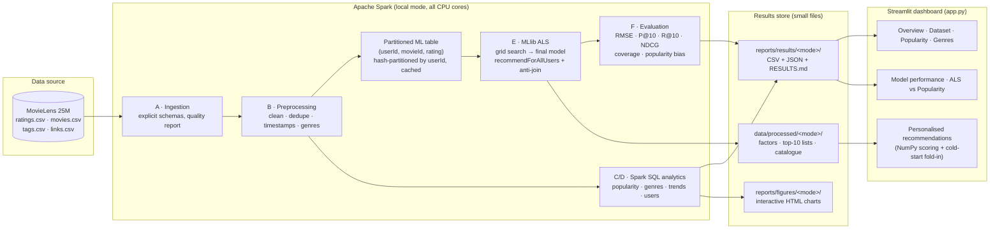
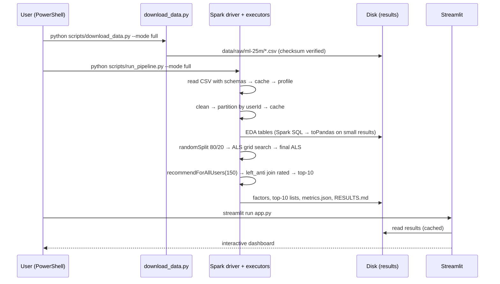

# System Architecture

## 1. Overview

The system has three layers:

1. **Big Data processing (offline, PySpark).** Spark runs in *local mode* on a single laptop. It ingests the 25M-row MovieLens dataset, cleans it, runs Spark SQL analytics, trains the ALS model with Spark MLlib, generates top-10 lists for every user and evaluates the model.
2. **Results store (files).** Spark writes only small, aggregated outputs: CSV/JSON results, the latent-factor matrices and the recommendation lists. The full ratings table is never converted to pandas.
3. **Presentation (online, Streamlit + Plotly).** The dashboard reads those files and serves recommendations with NumPy dot products. It never starts Spark, so it opens in seconds.

## 2. Data flow, step by step

## 3. Why this design

| Decision | Reason |
|---|---|
| Spark **local mode** (`local[*]`) | Uses every CPU core as a parallel worker without needing a Hadoop/YARN cluster. The same code runs unchanged on a real cluster by changing `spark.master`. |
| **Explicit schemas** for CSV | Avoids a full extra pass over 25M rows for `inferSchema`, keeps `imdbId` as a string (leading zeros) and turns malformed values into nulls we can count. |
| **Hash-partitioning by `userId`** + `cache()` | All ratings of one user sit in the same partition, which reduces shuffling for per-user work; caching avoids re-reading the CSV for each of ALS's iterations. |
| **Adaptive Query Execution** | Spark merges tiny shuffle partitions at runtime, so a single `shuffle_partitions` setting works for both the 100k and the 25M dataset. |
| **Spark SQL** for analytics | Declarative queries that read like the report; Catalyst optimises them (e.g. broadcast join with the small movies table). |
| **No Spark writes** (pandas saves the small results) | On Windows, Spark's Hadoop writer needs `winutils.exe`. Saving only aggregated outputs with pandas avoids that and keeps the project runnable on any laptop. |
| **Factors exported for serving** | Predicting is just `p_u · q_i`. Exporting P and Q lets the dashboard recommend in milliseconds and handle **cold-start** users by "folding in" a new user vector. |
| **Dev and full modes** | Dev mode (ml-latest-small, about 100k ratings) runs in minutes for development and testing; full mode processes all 25M ratings. Outputs are kept in separate folders. |

## 4. Module map

| Layer | File | Responsibility |
|---|---|---|
| Config | `src/config.py`, `config/config.example.yaml` | Modes, paths, Spark memory, ALS grid |
| Spark | `src/spark_session.py` | Local Spark session tuned for a laptop |
| A | `src/ingestion.py` | CSV → DataFrames, schemas, counts, missing values, duplicates |
| B | `src/preprocessing.py` | Cleaning rules, timestamps, year/genre parsing, ML table, split |
| C | `src/eda.py` | Runs the analytics, saves tables, exports Plotly HTML |
| D | `src/analytics.py` | Spark SQL queries: popularity, tiers, genres, trends, user behaviour |
| E | `src/recommendation.py` | ALS tuning/training, top-10 for all users, export |
| E | `src/recommender_core.py` | NumPy serving: scoring, exclusion, cold-start fold-in, similar movies, reference ALS |
| F | `src/evaluation.py`, `src/metrics.py` | RMSE, baselines, ranking metrics, coverage, popularity bias |
| Report | `src/report.py` | `RESULTS.md` and README results section from the real outputs |
| UI | `app.py`, `dashboard/*.py`, `src/visuals.py` | Streamlit pages, theme, Plotly charts |
